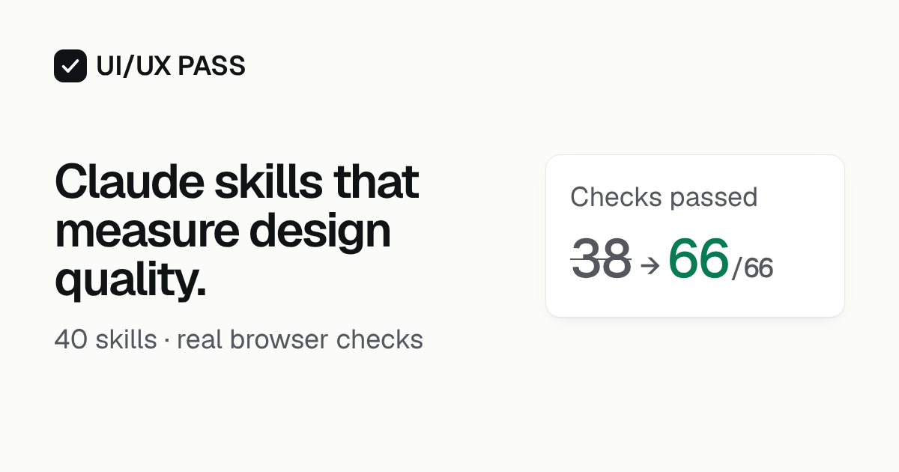

# Second Pass (free): design review skills that measure, not guess

Two free Claude skills from **Second Pass** by **UI/UX Pass**. They review screens, flows and any deliverable the way a meticulous senior designer would, with measured numbers instead of opinions.



| Skill | What it does | Try asking |
|---|---|---|
| `heuristic-ux-copy-review` | Reviews one screen or a whole flow against Nielsen's 10 heuristics and UX copy (labels, buttons, errors, empty states) in two tables, with measured color contrast and a source for every principle. | "Review this checkout flow" + screenshots |
| `self-review` | Checks any deliverable (interface, report, deck, doc) against five questions and a side-by-side with best-in-class work, and runs a script that checks the delivery format. | "Is this good enough to send?" |

## Install

**Claude.ai (Pro, Max, Team, Enterprise):** download this repository as a ZIP, then in Claude open Customize → Plugins → Add and upload it. Or add it from the Claude directory once it is listed.

**Claude Code:**

```
/plugin install second-pass-free --marketplace uiuxpass/second-pass-free
```

**Cursor, Codex and other agents (Agent Skills standard):**

```
npx skills add uiuxpass/second-pass-free
```

Check it works: ask *"Review this screen for UX and copy"* with a screenshot. You should get two tables (screen level and flow level) with contrast ratios measured from the image.

## Want the measured version of everything?

These are 2 of the 40 skills in Second Pass. The full kit adds a 66-check interface checker that runs in a real browser and fixes what it finds, a WCAG 2.2 AA audit, design-token checks, pixel-diff design QA, usability-test and A/B-test statistics, specs, decks, brochures and more.

- **Free in-browser checker:** paste any page and get 16 measured checks in 30 seconds at [uiuxpass.com/check.html](https://uiuxpass.com/check.html)
- **Full kit:** [uiuxpass.com](https://uiuxpass.com), $49 once, lifetime updates

## License

MIT for the two skills in this repository. Second Pass and UI/UX Pass are independent products, not affiliated with or endorsed by Anthropic. Claude is a trademark of Anthropic.
